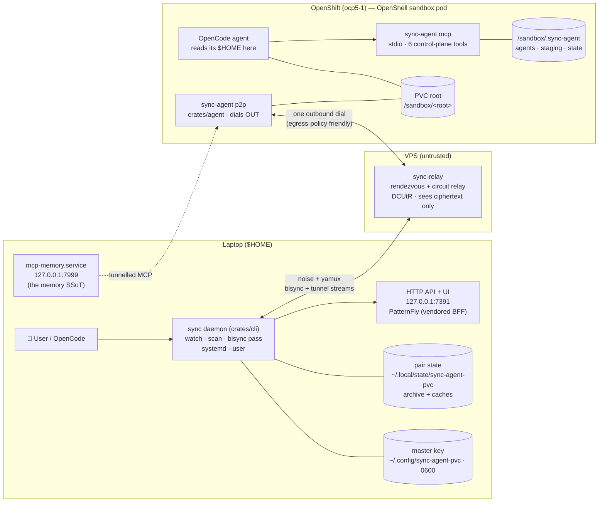
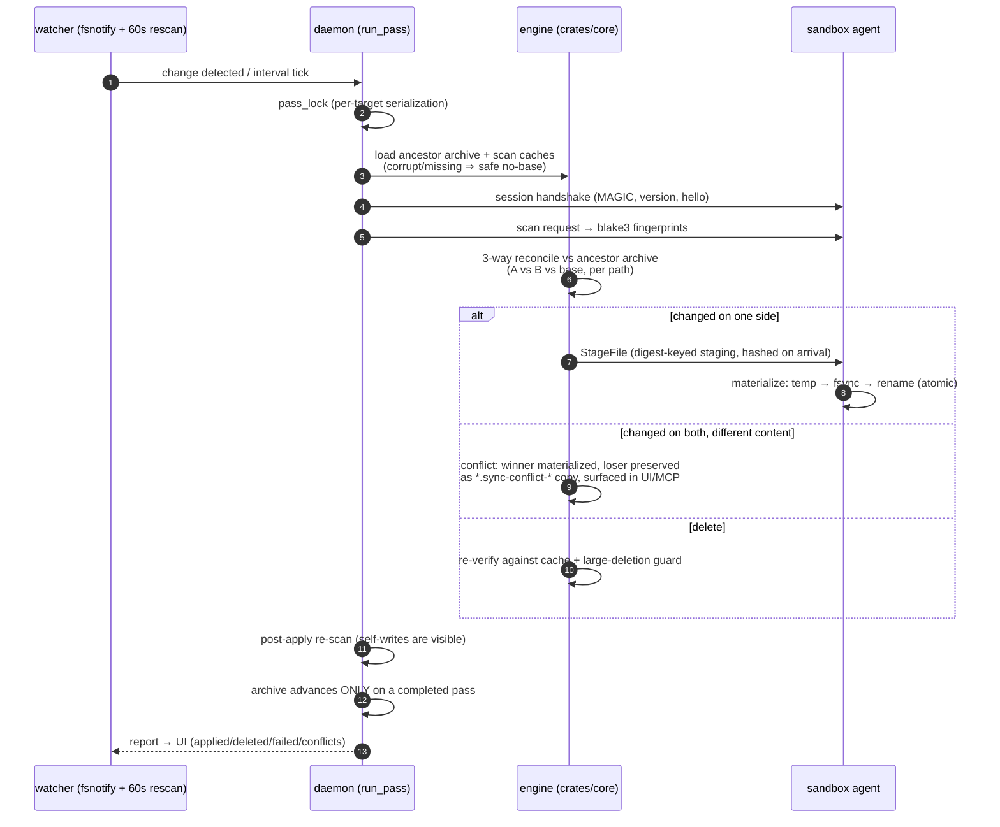
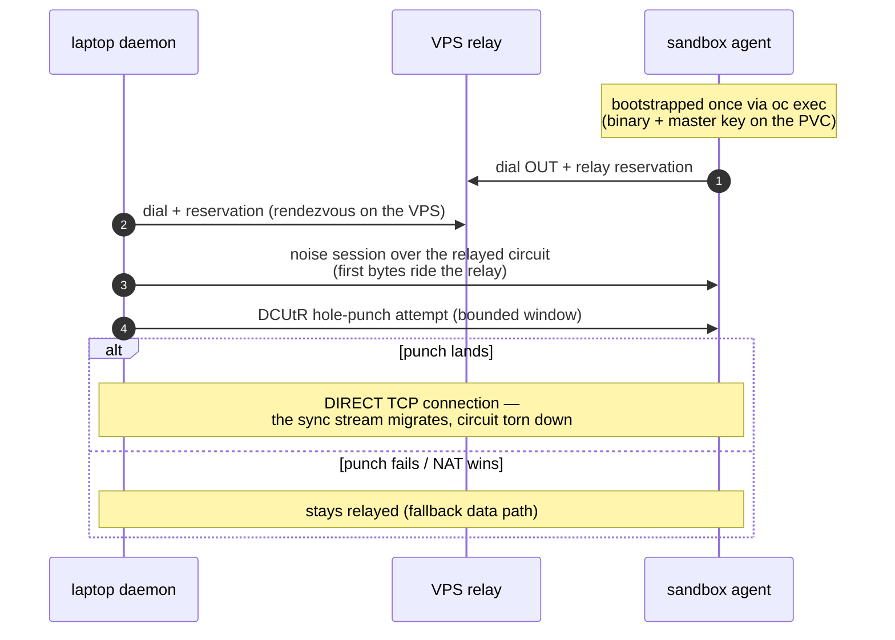
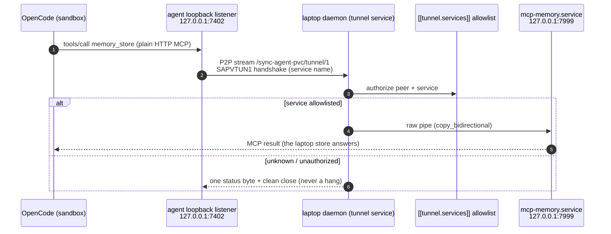
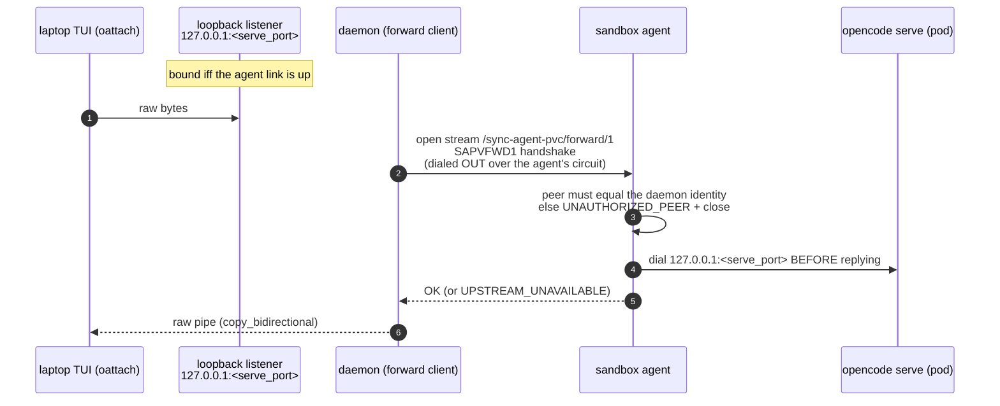
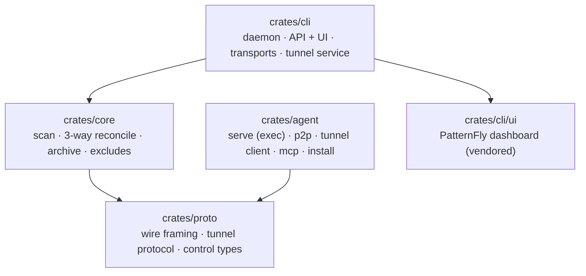

# Architecture

`sync-agent-pvc` keeps a laptop `$HOME` directory and an OpenShell sandbox's PVC
sync root converging — bidirectionally, over a noise-encrypted P2P link — and
tunnels laptop services (the memory MCP) to sandbox agents through the same
link. This document is the map; `docs/design-faq.md` is the *why*; the animated
walk-through lives at
[eformat.github.io/sync-agent-pvc](https://eformat.github.io/sync-agent-pvc/)
(source: `docs/flow-story.html`).

## The big picture

Two authoritative copies — the laptop and the PVC are both *real, local
filesystems*. Neither is a cache of the other; divergence is expected state
that the engine converges, not an error to prevent. That inversion (vs NFS) is
the whole design; see [docs/design-faq.md](docs/design-faq.md).

## A bisync pass

Every pass is the same shape, whichever transport (P2P stream or `oc exec`
fallback) carries it:

Load-bearing details:

- **No clock trust across machines.** Fingerprints are mtime + blake3; mtimes
  only power the *local* warm-scan quick-check. Every cross-machine "did this
  change?" is settled by content digest against the ancestor archive — a
  10-hour sandbox clock skew (seen live) costs a re-hash, never a wrong
  decision.
- **No partial truth.** Staged writes go to `.sync-agent-tmp-*` temps and
  rename into place atomically; the archive only advances when a pass
  *completes*. A pass killed at 80% leaves both sides converged on the applied
  80% (idempotent by digest) and the rest re-planned next pass.
- **Corrupt archive ⇒ safe no-base.** Undecodable/version-mismatched/foreign
  archives load as `None` and the pass becomes a full rescan with deletes
  disabled ("no-base never deletes" — deletion needs positive evidence).

## Transport ladder

The relay is untrusted infrastructure: it sees only noise-encrypted traffic.
Neither side ever listens inbound — everything is an outbound dial, so cluster
egress policy needs exactly one allowance (the VPS). Agent identities are
derived, not enrolled: `PeerId = derive(master_key, sandbox_id)`, pinned TOFU
and matched strictly thereafter.

The attach path is the newest rung: the reverse-forward (M9) carries the laptop
TUI's bytes to the pod's `opencode serve` over the same relay — **no
openshell/OIDC anywhere in the data path**. The `openshell forward service`
route is fallback only (and dies with the ~1 h gateway JWT).

## The memory tunnel (M5)

Sandbox OpenCode gets the laptop's memory MCP — the same tools, the laptop
store as the single source of truth — through the P2P link:

- **Default-deny on the laptop.** The allowlist lives in the daemon's config —
  an agent cannot opt itself into a service, and unlisted services are refused
  cleanly. This is the "memory access broker" pattern: future laptop services
  are new allowlist entries.
- **Offline writes spool.** While the tunnel is down, spool-listed write tools
  are appended to `<root>/.sync-agent/tunnel-spool/<service>.jsonl`
  (scanner-skipped) and answered with an honest "write spooled" result; reads
  fail fast to a clean miss. On reconnect a FIFO flush replays the spool —
  idempotent because the store is content-addressed.
- **Deterministic tunnel identity.** The daemon's tunnel PeerId is derived
  from the shared master key, so agents compute it with no rendezvous.

## The attach path (M8)

The laptop drives the pod's own OpenCode. The daemon spawns an `opencode serve`
inside the sandbox; `oattach` points a laptop OpenCode TUI at it through the P2P
forward (below). The TUI runs locally, so clipboard paste and copy work natively —
Ctrl+V pastes a laptop screenshot into the remote session, copy lands back on the
laptop clipboard; only the prompt content rides the link.

- **Daemon-owned serve.** `opencode serve` runs beside the agent on a
  deterministic per-sandbox port — blake3 of the qualified sandbox id →
  `4100 + hash % 400` (4388 for `plan`) — derived identically by daemon and agent
  with no config channel. The sync pass self-heals serve drift with a serve-scoped
  respawn (never touches the agent). The serve runs with cwd `/sandbox`, so an
  attached TUI lands there.
- **Mediated spawn.** The serve (like the agent) is spawned through the mediated
  exec path (`openshell sandbox exec`): the 0.1.8-pre.33 sandbox runtime
  egress-denies every `oc exec`-spawned process — DNS *and* TCP — so an
  oc-exec-spawned serve could never reach its inference endpoint. oc-exec stays
  as the fallback.
- **`oattach`.** Target + port come from the daemon API; the password is
  discovered from the pod's serve logs and every candidate is verified against
  the live serve (`GET /openapi.json`, HTTP BASIC) before launch. Both
  `OPENCODE_PASSWORD` and `OPENCODE_SERVER_PASSWORD` are exported — the client
  prefers the first, and an unexported assignment never reaches it. Secrets live
  in env only, never argv.
- **`oattach restart`.** A wedged serve is a one-liner: the wrapper POSTs
  `/api/targets/{name}/serve-restart`, the daemon kills the serve by port and
  re-runs the spawn body, and `oattach` polls the port and re-attaches — a
  restarted serve appends a fresh password, which the verify loop picks up.

## The reverse-forward (M9)

The attach path rides the P2P link itself — no `openshell forward`, no gateway
JWT, no OIDC anywhere in the data path:

- **Dial-out only.** The daemon dials the agent's existing relay circuit; nothing
  new listens inbound. The laptop loopback listener binds **iff** the agent link
  is up (bound on ConnectionEstablished, dropped on ConnectionClosed) — a dead
  p2p path fails fast (ECONNREFUSED) and leaves the port free for the
  openshell-forward fallback.
- **Protocol.** `/sync-agent-pvc/forward/1`, MAGIC `SAPVFWD1`, one status byte
  (OK / UNAUTHORIZED_PEER / UPSTREAM_UNAVAILABLE / BAD_HANDSHAKE), then a raw
  pipe. The handshake is deliberately port-less: both ends derive the serve port
  from the sandbox id (above).
- **One peer, one reservation.** The daemon once held three relay connections
  under one derived identity (sync dials + tunnel listener + forward client) and
  the relay intermittently mis-resolved the reservation. The tunnel listener now
  derives its own peer — `derive_tunnel_identity_seed` =
  blake3(master, "sync-agent-pvc/v1/tunnel") — so one peer = one connection = one
  reservation; sync and forward keep the original identity, and the forward's
  peer check is unchanged.
- **Zombie self-heal.** A daemon restart can kill the agent's tunnel circuit
  without the relay ever delivering ConnectionClosed — the link flag stays true
  and every request quietly takes the offline path. A stream-open failure while
  the driver believes the link is up IS the zombie signature: the flag clears and
  the tick re-dials. The tick also ground-truths the flag from the swarm
  (`is_connected`), so a link that is actually up is restored, never wedged.
- **Serve restart.** `oattach restart` drives `POST /api/targets/{name}/serve-restart`
  (kill by port → mediated respawn → fresh password), so a wedged serve never
  needs a pod login.

## Control plane (MCP)

The sandbox's `opencode.json` carries two MCP servers:

| Server | Transport | Tools | Purpose |
|---|---|---|---|
| `sync-agent` | stdio (`sync-agent mcp`) | `sync_status`, `sync_pause/resume`, `sync_resolve_conflict`, `sync_now`, `sync_ignore_add` | the agent sees and steers its own sync |
| `memory` | Streamable HTTP → tunnel | the laptop memory toolset (`memory_store`, `memory_search`, …) | same memory tools as laptop OpenCode |

The control plane reads the daemon-written `sync-state.json` and writes
`control-requests.json` (pause/resume/resolutions/ignore-adds) which the next
pass fetches and honors — no bulk file data ever rides it.

## State layout

| Location | Contents |
|---|---|
| `~/.local/state/sync-agent-pvc/pairs/<pair-hash>/` | laptop: ancestor archive + scan caches (legacy `<root>/.sync-agent` migrated on first run) |
| `/sandbox/.sync-agent/agents/<version>/` | versioned agent binaries + `current` symlink (GC'd on install) |
| `/sandbox/.sync-agent/agent/<hash>/` | sandbox: digest-keyed staging |
| `<root>/.sync-agent/` | scanner-skipped state dir: control files, tunnel spool, `.syncignore` lives beside it |

`.syncignore` (mutagen glob syntax) is synced content — edit it on either side.

## Crate map

| Crate | Role |
|---|---|
| `crates/core` | sync engine: scan (blake3), 3-way reconcile, archive, excludes (vendored copia cores) |
| `crates/proto` | MAGIC handshake + bounded-length CBOR/bincode frames, tunnel handshake, control types, `derive_tunnel_identity_seed`, the forward protocol + derived serve port |
| `crates/agent` | remote agent: `serve` (exec/stdio), `p2p` (driver + transports), tunnel client + spool, MCP server, self-installing binaries |
| `crates/cli` | laptop daemon: per-target pass loops, localhost API + vendored PatternFly UI, P2P/exec transports, tunnel service + allowlist, attach path (`agent_spawn_script` / `serve_remote` / `run_remote_mediatted` mediated spawns, the serve-restart route) |

## Failure semantics (the chaos gate)

| Failure | Behavior |
|---|---|
| Daemon killed mid-pass | staged temps only; archive not advanced; next pass re-plans the remainder |
| Agent/pod killed mid-transfer | staging hashed on arrival; digest mismatch = retry, never a corrupt apply |
| Corrupt archive (and its `.bak`) | safe no-base: full rescan, deletes disabled, re-seeds the archive |
| Cluster/API outage | pass errors are per-target; laptop unaffected; resumes when reachable |
| Mass deletion (bad pair key, stale tree) | large-deletion guard halts the pass and demands a human |
| Tunnel down | writes spool (FIFO, idempotent), reads miss cleanly, flush converges on reconnect |
| Unknown tunnel service / stranger peer | one status byte + clean close; counted in `/api/tunnel` refusals |
| Every "port listening" gate (awk) | awk exits 0 even with zero matches — every serve gate was vacuously true and the M8 self-heal was dead code; fixed with `awk '… { s=1 } END { exit s ? 0 : 1 }'` (test the negative case) |
| 0.1.8-pre.33 platform regressions | the network_broker egress-denies oc-exec-spawned processes (DNS + TCP) → agent + serve spawn via mediated `openshell sandbox exec`; the supervisor matches the policy binaries list against the RESOLVED agent path → policy v5 + a per-deploy registration follow-up |
