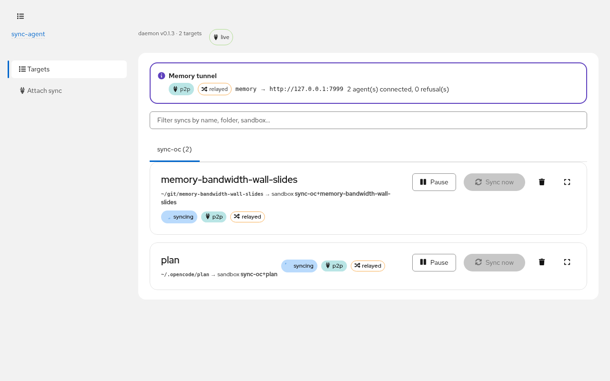
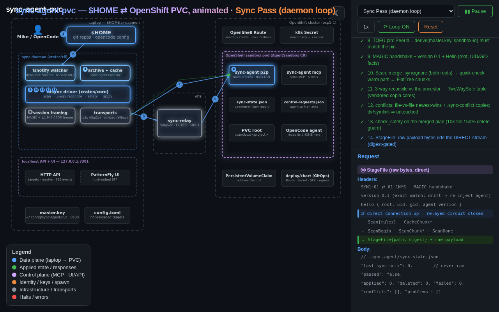
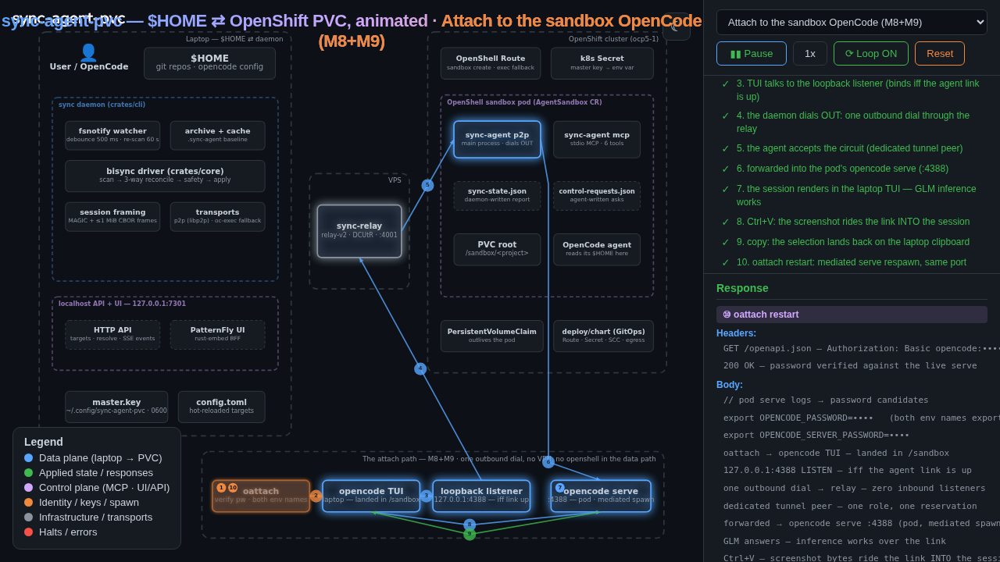
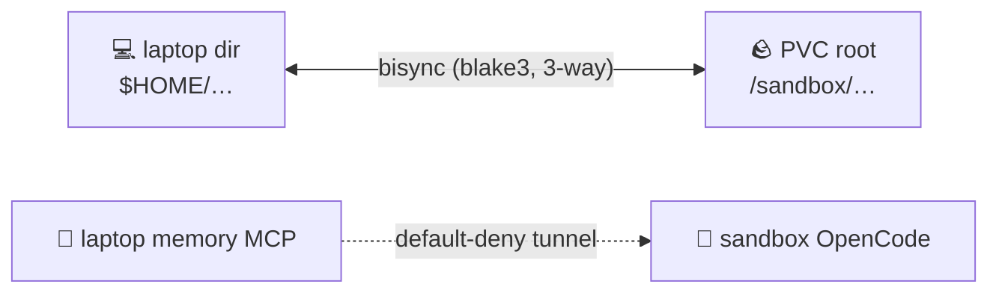

# 🦩 sync-agent-pvc

**Your laptop's files *and* your memory, alive inside every sandbox your agents live in.**

Bidirectional sync of a laptop directory to an OpenShift PVC so [OpenCode](https://opencode.ai)
agents running in OpenShell sandboxes work with real local context — over a noise-encrypted
P2P link that survives NAT, cluster outages, and your laptop being shut — plus a
**default-deny tunnel** that gives sandbox agents the laptop's memory MCP as if it were local.

[](#status)
[](#status)
[](https://rustlang.org)
[](https://eformat.github.io/sync-agent-pvc/)

<p align="center">
  
</p>

---

## Why

OpenCode agents in OpenShell sandboxes run on PVCs. My actual work — git repos,
plans, config, and the memory store my agents think with — lives on my laptop. I want agents
to work like they're **on** my laptop while the laptop can be closed and the cluster can be
rebuilt from GitOps any afternoon.

So: **the laptop is the durable tier; the sandbox is a fast, disposable working set.** Two
real disks, one honest reconciliation protocol, and a tunnel that brings the memory broker
along. (Noel asked the hard questions — [he's answered below](#noel-asked-the-hard-questions-).)

## What you get

- 🔁 **True bisync** — 3-way reconcile against a content-addressed ancestor archive; edits,
  deletes, and conflicts converge from either side. Whole-file conflicts keep the loser as a
  `.sync-conflict-*` copy and resolve explicitly (UI or sandbox MCP) — no silent merges, ever.
- 🕳️ **P2P that punches** — libp2p over TCP (noise + yamux): rendezvous + circuit relay
  fallback, DCUtR hole-punch upgrades to a direct path when NAT allows. One outbound dial,
  no inbound exposure, no VPN, untrusted relay.
- 🧠 **The memory tunnel** — sandbox agents call the laptop's memory MCP through the link
  with the *same tools* (memory_store, memory_search, …). The laptop allowlist is
  **default-deny**: agents can't opt themselves in. Offline writes spool and flush
  idempotently on reconnect.
- 📋 **Clipboard across the boundary** — `oattach` opens the laptop TUI on the pod's own
  `opencode serve`: you land in `/sandbox`, Ctrl+V pastes a laptop screenshot into the
  remote session, and copy lands back on the laptop clipboard — both directions verified.
- 🔄 **`oattach restart`** — a wedged serve is a one-liner: the daemon kills and respawns
  it, the wrapper polls the port and re-attaches with the fresh password. No pod login.
- 🛠️ **Self-managing agents** — the daemon provisions, upgrades, and health-checks the
  in-sandbox agent every pass (version drift → re-provision); the dashboard surfaces agent
  version, tunnel args, and MCP health per target.
- 🎛️ **A real dashboard** — localhost-only PatternFly UI + API: live phases, conflicts,
  refusals, tunnel state, attach wizard with dry-run preview.
- 🧨 **Honest failure modes** — corrupt archive ⇒ safe no-base rescan (deletes disabled);
  killed mid-pass ⇒ staged temps only, archive never half-advances; mass-deletion guard
  demands a human.

## Screenshots

| | |
|---|---|
|  |  |
| **Attach wizard** — pick a dir, name the sandbox, dry-run preview | **[Flow story](https://eformat.github.io/sync-agent-pvc/)** — the whole design, animated |

## How it works (30 seconds)

The laptop daemon watches your directory, runs a bisync pass against the sandbox's PVC root
over a noise-encrypted libp2p session (relay fallback, DCUtR direct upgrade), and reconciles
both trees against the ancestor archive. The sandbox agent is self-provisioned onto the PVC
and kept on the daemon's version. The same link tunnels allowlisted laptop services — like
the memory MCP — to the sandbox's loopback.



Deep dive: **[ARCHITECTURE.md](ARCHITECTURE.md)** (mermaid) ·
**[animated flow story](https://eformat.github.io/sync-agent-pvc/)** ·
**[design FAQ](docs/design-faq.md)**.

## Quickstart

Build (Rust 2024, one workspace):

```bash
cargo build --release
```

Laptop side — a config file and a user unit:

```toml
# ~/.config/sync-agent-pvc/config.toml
[daemon]
bind = "127.0.0.1:7391"

[tunnel]
enabled = true

[[tunnel.services]]                       # the default-deny allowlist
name = "memory"
upstream = "http://127.0.0.1:7999"        # your laptop's memory MCP
agent_port = 7402
spool_tools = ["memory_store", "memory_delete"]

[[targets]]
name = "plan"
sandbox = "sync-oc+plan"                  # must match the agent's --sandbox-id
root = "~/code/plan"                      # laptop side ($HOME convention)
root_remote = "/sandbox/.opencode/plan"   # PVC side
transport = "p2p"
relay = "/ip4/VPS/tcp/4001/p2p/RELAY_PEER"
tunnel_services = ["memory"]              # opt this target into the tunnel
```

```bash
~/.local/bin/sync-agent daemon --config ~/.config/sync-agent-pvc/config.toml
# dashboard: http://127.0.0.1:7391
```

Sandbox side — nothing to do by hand: on the first pass the daemon bootstraps the agent
onto the PVC (over `oc exec`), derives its identity from the master key, and every pass
after that self-upgrades it if the version drifts. The curious can watch it work:

```bash
/sandbox/.sync-agent/agents/current/sync-agent p2p \
  --relay '/ip4/VPS/tcp/4001/p2p/RELAY_PEER' \
  --sandbox-id 'sync-oc+plan' \
  --master-key-file /sandbox/.sync-agent/master.key \
  --root /sandbox/.opencode/plan \
  --tunnel 'memory@7402:memory_store,memory_delete'
```

Point the sandbox's `opencode.json` at the two MCP servers — `sync-agent` (stdio, the
control plane) and `memory` (remote, `http://127.0.0.1:7402/mcp`, the tunnel) — and the
agent has the same tools as laptop OpenCode.

> **One-time cluster prep** (OpenShell on OpenShift, SCC + Route + egress): see
> [docs/m0.0-runbook.md](docs/m0.0-runbook.md) and `deploy/chart/`.

Attach — drive the pod's OpenCode from the laptop:

```bash
oattach        # the TUI opens connected to the pod's opencode — you land in /sandbox
# Ctrl+V pastes a screenshot from the laptop clipboard into the remote session
```

## Noel asked the hard questions 🎤

Noel opened with *"you just reinvented NFS"*, then followed with
*"how does the 'solution' handle synchronous conflicts and time deltas, also packet loss?"*
Both are the right questions — they're exactly where sync systems fall over. Short answers
here; the full roast with live receipts is in [docs/design-faq.md](docs/design-faq.md).

**"You just reinvented NFS."**
NFS pretends the network is a disk. This is the opposite: **two real disks disagree and have
to make up.** NFS has one authoritative copy and clients borrow it — unmount it and the
files are gone; mount it over WAN and every tool crawls. Here the laptop and the PVC are
both real, fast, local filesystems, *both* authoritative: the sandbox stays instant when
your laptop is shut, and your laptop stays instant when the cluster is dark. Everything hard
in this project — conflict staging, the deletion guard, pair-keyed archives, relay fallback,
spooling — exists **only** because there are two copies. NFS never has to solve any of it.

> NFS answers *"where do the files live?"* — one place, and you go to them.
> We answer *"the files live in two places, the network between them is hostile, and here's
> the protocol for them to converge anyway."*

**"Synchronous conflicts?"**
A truly simultaneous edit is indistinguishable from sequential divergence, so the design
doesn't try to detect simultaneity — it makes divergence well-defined. Every pass compares
both trees against the **ancestor archive** (the last state both sides agreed on): changed
on one side → it wins; both, identically → no-op; both, differently → **conflict** — the
loser's content is preserved as a conflict copy, the winner materializes, and a human
resolves explicitly in the dashboard or via the sandbox's `sync_resolve_conflict` MCP tool.
No distributed locking, no silent last-write-wins — and a plan that deletes too much of the
tree **halts and demands a human**.

**"Time deltas?"**
Clocks are never compared across machines. Fingerprints are mtime + blake3, but mtimes only
power the *local* warm-scan quick-check; every cross-machine "did this change?" is settled
by content digest against the archive base. The sandbox clock ran **ten hours behind** the
laptop during live testing — the sync converged anyway, because a clock skew costs at most a
re-hash, never a wrong decision.

**"Packet loss?"**
Below the stream it's TCP's problem. What the sync handles is what loss *implies*: torn and
dead connections. Wire framing validates magic + length on every message (a mid-stream EOF
is detected, not guessed); interrupted passes leave staged temps, never half-written
targets; the archive only advances when a pass **completes**; sessions reconnect with
backoff and re-run — a pass killed at 80% leaves both sides converged on that 80% (idempotent
by digest) and re-plans the rest.

**Why I built this**
My agents work where my work lives: on this laptop, in `$HOME`, with the memory store they
think with. But agents increasingly run in sandboxes — ephemeral PVCs on clusters that get
rebuilt from GitOps any afternoon. I didn't want an NFS mount, a VPN, or a sync tool that
treats divergence as an error; I wanted the laptop to stay the durable tier while sandboxes
come and go. So: two real disks, one honest protocol, self-managing agents, and a
default-deny tunnel so "my memory" travels with the agent without the cluster ever becoming
the source of truth.

## Status

| Phase | Delivers | State |
|---|---|---|
| M0.0 | OpenShell on OpenShift (GitOps chart, SCC, egress) | ✅ |
| M0 | spikes: framing, bisync, relay, sandbox egress | ✅ |
| M1 | engine: scan · 3-way reconcile · archive · excludes | ✅ |
| M2 | wire protocol + agent (serve, staging, control files) | ✅ |
| M3 | P2P transport (relay, TOFU pin) + oc-exec fallback | ✅ |
| M3.5 | sandbox MCP control plane (6 tools) | ✅ |
| M4 | daemon + localhost API + PatternFly dashboard | ✅ |
| M4.5 | DCUtR direct-path upgrade (relay → fallback only) | ✅ |
| M4.6 | dashboard vendored into the daemon + Keycloak OIDC demo | ✅ |
| M5 | memory access broker: tunnel + allowlist + spool + Sync-UI | ✅ e2e gate passed |
| M6 | hardening: empty-overwrite guard, install-versioning fix, control-state relocation, first-run dry-run, wizard presets + collision guard, self-inversion contract, pass tracing, chaos gate | ✅ |
| M7 | docs: README, ARCHITECTURE (mermaid), Pages flow story, screenshots | ✅ this |
| M8 | clipboard/attach: pod-side `opencode serve` + `oattach` + paste/copy both directions | ✅ e2e verified |
| M9 | p2p reverse-forward: attach to the pod's opencode with no openshell/OIDC in the data path | ✅ e2e verified |

**294 tests green · clippy clean.** The plan of record lives at
`~/.opencode/plan/sync-agent-pvc.md` (local; not in git).

## Docs

| Doc | What |
|---|---|
| [ARCHITECTURE.md](ARCHITECTURE.md) | the system in mermaid: passes, transports, tunnel, state, failure semantics |
| [docs/design-faq.md](docs/design-faq.md) | the full NFS roast + conflicts/clock-skew/packet-loss receipts |
| [Flow story on Pages](https://eformat.github.io/sync-agent-pvc/) | the design, animated, step by step |
| [docs/m0.0-runbook.md](docs/m0.0-runbook.md) | cluster prep runbook (OpenShell on ocp5-1) |
